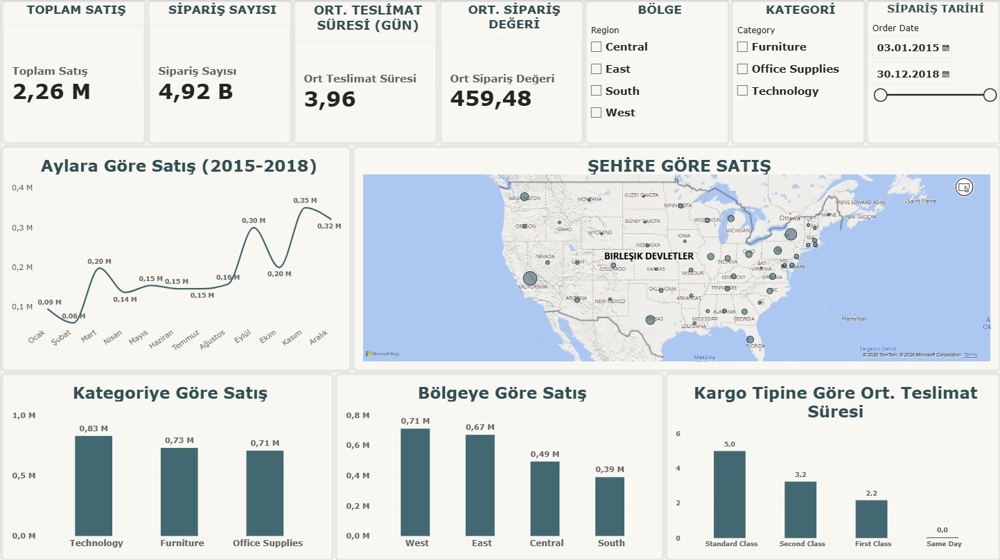

# powerbi-superstore-dashboard
# Superstore Satış Dashboard'u (Power BI)

2015-2018 dönemi perakende satış verisiyle hazırladığım interaktif Power BI dashboard'u. Satışların nerede, ne zaman ve hangi teslimat yöntemiyle gerçekleştiğini tek sayfada gösterir.



## Kullanılan Araçlar
- Power BI Desktop
- Power Query (veri temizleme)
- DAX (ölçüler)

## Veri Seti
Kaggle - Superstore Sales veri seti: [https://www.kaggle.com/code/hbsaakashyadav/superstore-sales]

## Dashboard İçeriği
- KPI kartları: Toplam Satış, Sipariş Sayısı, Ortalama Sipariş Değeri, Ortalama Teslimat Süresi
- Aylara göre satış trendi (2015-2018 aylarının toplamı)
- Şehre göre satış haritası
- Kategori, bölge ve kargo tipine göre grafikler
- Filtreler: Bölge, Kategori, Sipariş Tarihi

## DAX Ölçüleri
```
Toplam Satış = SUM(Superstore[Sales])

Sipariş Sayısı = DISTINCTCOUNT(Superstore[Order ID])

Ort Sipariş Değeri = DIVIDE([Toplam Satış], [Sipariş Sayısı])

Ort Teslimat Süresi = AVERAGEX(Superstore, DATEDIFF(Superstore[Order Date], Superstore[Ship Date], DAY))
```

## Öne Çıkan Bulgular
- Toplam satışın yaklaşık %61'i West ve East bölgelerinden geliyor.
- Eylül, Kasım ve Aralık aylarında satışlar yıllık toplamın yaklaşık %43'ünü oluşturuyor.
- Kategoriler dengeli: Technology 0,83 M, Furniture 0,73 M, Office Supplies 0,71 M.
- Ortalama teslimat süresi kargo tipine göre belirgin değişiyor: Standard Class 5,0 gün, Second Class 3,2 gün, First Class 2,2 gün.

## Veri Temizleme Notu
Türkçe bölgesel ayarlar yüzünden `Sales` sütunundaki ondalık nokta binlik ayırıcı sanılıp silinmişti ve toplam satış yaklaşık 1000 kat şişmişti. Power Query'de sütun türünü "Yerel ayar kullanarak" İngilizce (ABD) ayarıyla dönüştürerek düzelttim.

## Dosyalar
- `[Satış dashboardu].pbix`: Power BI dosyası
- `Satış dashboardu.png`: Dashboard ekran görüntüsü

## İletişim
[Yasin Sarışahin] - [https://www.linkedin.com/in/yasin-sarişahin-692860234/]  
